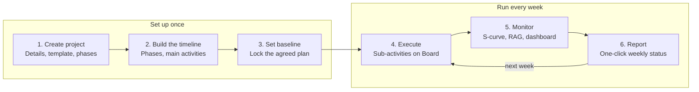

# minipmo: Product Requirements Document

Oct 21, 2026

## Overview

minipmo is my personal PMO tool: I create a project in under 10 minutes and see, at any point, where it stands, what is at risk and what needs a decision.

**Problem.** PMO teams run projects across MPP files, Excel trackers, slide decks and email. Progress percentages are calculated inconsistently, weightages are hidden in spreadsheets, and weekly status reports are rebuilt by hand. Leadership gets a late, partial picture.

**Vision.** One lightweight tool, for my own use, that holds the plan, tracks weighted progress, runs the RAID log and generates the status report from the same data. No server, no logins, no licences: it runs in the browser and backs up to GitHub as JSON.

**Goals**

- One source of truth for timeline, progress, risks and decisions per project
- Transparent weighted progress that anyone can trace back to its tasks
- Executive view of all projects on one screen
- Weekly status report produced in one click

**User**

One user: me, as PM across my own projects. Other people appear only as names (e.g. the owner of a RAID action I am chasing), not as accounts.

**Success metrics (first 3 months after launch)**

- Project setup in under 10 minutes
- Weekly update of all my sub-activities in under 5 minutes
- Status report ready in under 15 minutes
- Zero data loss: every change backed up to GitHub

## Scope

Phase 1 delivers 14 modules (the 12 agreed features plus project setup and GitHub backup) that take a project from creation to weekly reporting. Everything else is parked until Phase 1 is adopted.

| # | Module | Purpose |
| --- | --- | --- |
| 1 | Project setup | Create a project with dates, phases and main activities |
| 2 | Timeline (Gantt) | Phases, main activities, sub-activities and milestones on a time axis |
| 3 | Planned % and weightages | Duration-based weightage, editable, rolled up to the project |
| 4 | Kanban board | Sub-activities, each tagged to a main activity on the timeline |
| 5 | S-curve | Weighted planned vs actual progress over time |
| 6 | RAG status | Rule-based health with justified override |
| 7 | Milestones and deliverables | Key gates with sign-off status |
| 8 | Dependencies | Finish-to-start links with knock-on warnings |
| 9 | Baseline | Locked original plan for variance tracking |
| 10 | RAID log | Risks, Actions, Issues, Decisions |
| 11 | Owners and accountability | Owner name and due date on every item; My Tasks view |
| 12 | Portfolio dashboard | All my projects on one screen |
| 13 | Status report generator | One-click weekly report from live data |
| 14 | Backup and restore | JSON backup to a private GitHub repo, restore from any version |

Also included: "last updated on" for every activity, risk and action, so stale items are visible.

**Out of scope for Phase 1**

- Server backend, user accounts, roles, SSO
- Change request log and re-baselining workflow
- Resource capacity view across projects
- Automated notifications and reminders
- Full audit trail
- Excel and MPP import / export
- Budget tracking, meeting minutes, AI summaries

## Core user journey

I set the project up once, then run a weekly loop that ends in a one-click status report.



Building the plan happens on the timeline only: phases and main activities, which takes under 10 minutes with a template. The detail comes later. Each sub-activity I add on the Board slots under its main activity and expands the timeline, so the plan grows with the work. Board updates then feed the S-curve and RAG automatically, and the report needs only my narrative.

## Functional requirements

Each module lists what it must do and how I know it works. The structure is fixed at three levels: **Phase → Main activity → Sub-activity**. Sub-activities are the unit of work on the Kanban; main activities and phases are the units of the timeline.

### 1. Project setup

- Create project with: name, code, sponsor (text), start date, end date, description, working calendar (working days and public holidays, with presets such as Malaysia or NSW, editable per project)
- Pick a template (Blank, Standard Waterfall, Implementation) that pre-fills phases and main activities
- 2-step wizard: Details → Phases, main activities and milestones. Step 2 is skippable
- **Acceptance:** I create a project with phases in under 10 minutes; it appears on the portfolio dashboard immediately

### 2. Timeline (Gantt)

- Three levels: Phase → Main activity → Sub-activity, with sub-activities nested under their main activity. The plan is built here as phases and main activities only; the timeline expands automatically as sub-activities are added on the Board
- A main activity's bar spans from its earliest sub-activity start to its latest sub-activity end, and updates automatically
- Drag bars to change dates; drag edges to change duration
- Today line, zoom (week, month, quarter), collapse phases and main activities
- Planned bar vs actual progress shading inside each bar
- **Acceptance:** changing a sub-activity date updates its main activity bar, the S-curve and dependency warnings in one action

### 3. Planned % and weightages

- Weightage is set automatically by duration (working days) at every level: sub-activity within main activity, main activity within phase, phase within project
- I can edit any weight. Edited weights are marked with a pin; unpinned weights in the same group rebalance so the group still totals 100%
- "Reset to duration" restores the default for a group
- Planned % calculated automatically from dates (see Progress logic)
- Actual % entered on sub-activities only; main activities and phases roll up
- **Acceptance:** hovering any project, phase or main activity % shows its breakdown down to the sub-activities

### 4. Kanban board

- Every card is a sub-activity, and every sub-activity must be tagged to a main activity. A card cannot be saved without one
- Cards created on the board appear under their main activity on the timeline; sub-activities created on the timeline appear on the board. One record, two views
- Each card shows its main activity tag (coloured by phase), dates, % and blocked flag
- Default columns: To Do, In Progress, Blocked, Done
- Moving a card to Done sets actual % to 100; moving to In Progress prompts for a %
- Blocked requires a reason and can raise an Issue in the RAID log in one click
- Filter or swimlane by main activity or phase
- **Acceptance:** moving a card updates its main activity's %, the phase %, the project % and the S-curve without refresh

### 5. S-curve

- Cumulative weighted planned % vs actual % over time, with baseline line when set
- Today marker and variance figure (e.g. "−6% behind plan")
- Available at project and phase level
- **Acceptance:** curve values match the progress table to one decimal place

### 6. RAG status

- Auto-calculated from schedule variance, overdue milestones and open high risks
- Manual override allowed with a mandatory reason, shown with an "overridden" tag
- RAG history kept week by week
- **Acceptance:** an executive sees the status and the reason in one view

### 7. Milestones and deliverables

- Milestone = zero-duration item with date, owner, and sign-off status (Pending, Submitted, Approved, Rejected)
- Deliverables attached to milestones with optional link to the document
- **Acceptance:** milestones show as diamonds on the timeline and as a list on the dashboard

### 8. Dependencies

- Finish-to-start links, drawn on the timeline or picked from a list
- If a predecessor slips past a successor's start, the successor is flagged; I choose to shift or keep
- **Acceptance:** circular dependencies are blocked with a clear message

### 9. Baseline

- "Set baseline" freezes dates, weightages and planned % for the project
- Timeline shows baseline bars in grey under current bars
- One active baseline in Phase 1; re-baselining requires a reason
- **Acceptance:** variance (days and %) shows for every activity once a baseline exists

### 10. RAID log

- Four tabs: Risks, Actions, Issues, Decisions
- Common fields: title, description, owner, due date, status, linked activity or milestone
- Risks: likelihood and impact (1–5), auto score, mitigation
- Issues: severity, resolution. Decisions: decided by, date, rationale
- **Acceptance:** an item without an owner or due date cannot be saved

### 11. Owners and accountability

- Every sub-activity, milestone and RAID item has an owner name (free text, defaults to me) and a due date
- My Tasks view: everything due across projects, overdue first
- "Last updated on" shown on every item
- **Acceptance:** stale items (no update in 7 days) are visibly marked

### 12. Portfolio dashboard

- One card or row per project: RAG, actual vs planned %, next milestone, top risk
- Filters: status, sponsor. Sort by variance or end date
- Click through to project overview
- **Acceptance:** loads in under 1 second for 20 projects

### 13. Status report generator

- One click builds the weekly report: RAG and reason, progress vs plan, S-curve, achievements this week, next week, milestones due, top risks and issues, decisions needed
- I edit narrative fields before finalising; numbers stay locked to data
- Export to PDF and PowerPoint (.pptx, one slide per report section); previous reports archived and included in the GitHub backup
- **Acceptance:** a report is ready to send in under 15 minutes

### 14. Backup and restore (GitHub)

- All data lives in the browser (IndexedDB) and is exported as one JSON file per project plus a settings file
- Backup commits the JSON to a private GitHub repo through the GitHub API, using a fine-grained token scoped to that one repo
- Auto-backup after changes (debounced, e.g. 2 minutes of no edits) plus a "Back up now" button, plus a daily snapshot the first time the app opens each day (a static app cannot run while closed); last backup time always visible
- Restore: pick any commit from the repo history and load it, after a confirmation
- Manual JSON download and upload as a fallback
- **Acceptance:** clearing the browser and restoring from GitHub brings back every project, report and setting exactly

## Progress, weightage and RAG logic

Progress rolls up by weightage from sub-activities to main activities to phases to the project, and every number can be traced back to its sub-activities.

**Weightage**

- Three weighted levels: sub-activity within its main activity, main activity within its phase, phase within the project
- Each group totals 100%
- Default suggestion: by duration in working days, e.g. a 6-day and a 4-day sub-activity weigh 60% and 40%. Editable: a weight I change is pinned, and the unpinned weights in that group rebalance to keep 100%

**Planned % for an activity (as of a date)**

- Before start date: 0%
- After end date: 100%
- In between: elapsed working days ÷ total working days (using the project's calendar)

**Actual % for an activity**

- Entered on sub-activities only: Kanban column (To Do 0%, Done 100%) or slider while In Progress
- Main activities, phases and the project are always calculated, never typed

**Roll-up**

- Main activity % = Σ (sub-activity weight × sub-activity %)
- Phase % = Σ (main activity weight × main activity %)
- Project % = Σ (phase weight × phase %)

The same formulas apply to planned and actual %. Variance = actual % − planned %.

**Worked example**

| Phase | Phase weight | Planned % | Actual % | Weighted planned | Weighted actual |
| --- | --- | --- | --- | --- | --- |
| Design | 30% | 100% | 100% | 30.0% | 30.0% |
| Build | 50% | 60% | 45% | 30.0% | 22.5% |
| Test | 20% | 0% | 0% | 0.0% | 0.0% |
| **Project** | **100%** | | | **60.0%** | **52.5%** |

Variance = −7.5%, so the project is Amber.

**RAG rules (defaults, configurable in Settings)**

| Status | Rule (any one triggers the worse status) |
| --- | --- |
| Green | Variance within −5%, no overdue milestone, no open risk scored 15+ |
| Amber | Variance −5% to −10%, or a milestone overdue up to 7 days, or a risk scored 15+ |
| Red | Variance worse than −10%, or a milestone overdue over 7 days, or an open critical issue |

Manual override is allowed with a mandatory reason and is tagged "overridden" everywhere it appears.

## Screens and navigation

Two levels of navigation: a left sidebar for the portfolio, and tabs inside each project. Any screen is at most two clicks from the dashboard.

**Global sidebar:** Portfolio · My Tasks · Reports · Settings

**Project tabs:** Overview · Timeline · Board · RAID · Reports

| Screen | What I see | Key actions |
| --- | --- | --- |
| Portfolio dashboard | Project cards with RAG, planned vs actual %, next milestone, top risk | Filter, sort, open project, + New project |
| Project overview | RAG with reason, progress dial, mini S-curve, upcoming milestones, top 5 RAID items | Override RAG, set baseline, edit project |
| Timeline | Gantt with phases, main activities, sub-activities, milestones, dependencies, baseline bars, today line | Drag dates, link activities, edit weightages |
| Board | Kanban columns with sub-activity cards, each showing its main activity tag, dates, % and blocked flag | Drag cards, quick-add, raise issue |
| RAID | Four tabs with filterable tables; risk heat map (5x5) | Add item, change status, link to activity |
| Reports | Generated weekly report, editable narrative, archive | Generate, edit, export PDF or PPT |
| My Tasks | Everything due across my projects, overdue first | Update %, mark done |

**Activity side panel.** Clicking any main activity or sub-activity, on any screen, opens the same right-hand panel: dates, weightage, planned and actual %, owner, parent main activity, dependencies, linked RAID items, last updated. One place to edit keeps the tool simple.

**Settings** holds the GitHub repo, token and backup status, plus RAG thresholds. Each project's working calendar is set in project setup.

## Data model

Ten core entities. The Activity is the centre: the timeline, the board, the S-curve and the report are all views of the same activity records.

| Entity | Key fields | Relationships |
| --- | --- | --- |
| Project | id, name, code, sponsor, start, end, calendar (working_days, holidays), status, rag, rag_reason, rag_overridden | has many Phases, RAID items, Baselines, Reports |
| Phase | id, project_id, name, order, weight, weight_pinned | has many main Activities |
| Activity | id, phase_id, parent_id, level (main / sub), name, owner, start, end, weight, weight_pinned, actual_pct, kanban_status, blocked_reason, updated_at | main: belongs to Phase, has many subs. sub: parent_id required (its main activity) |
| Milestone | id, project_id, name, date, owner, signoff_status, deliverable_link | belongs to Project |
| Dependency | id, predecessor_id, successor_id, type (FS) | links two Activities or Milestones |
| Baseline | id, project_id, set_at, reason, snapshot (dates, weights, planned %) | belongs to Project |
| RAID item | id, project_id, type (R/A/I/D), title, owner, due, status, likelihood, impact, severity, linked_activity_id, updated_at | belongs to Project |
| Progress snapshot | id, project_id, phase_id, date, planned_pct, actual_pct | daily record that draws the S-curve |
| Status report | id, project_id, week, rag, narrative fields, data snapshot, finalised_at | belongs to Project |
| Settings | github_repo, github_token, last_backup_at, rag_thresholds | one record, stored locally |

Main activity dates and % are derived from their sub-activities, not stored separately, so the timeline and the board can never disagree.

The daily **progress snapshot** is what makes the S-curve honest: actual % history is stored, not recalculated, so past points never move when I edit an activity today.

## UX and visual design principles

The tool wins on adoption, so every design choice optimises for fast updates and instant understanding.

**Interaction principles**

1. **Two-minute update.** I update all my sub-activities in under two minutes from the Board.
2. **Edit in place.** Inline editing on tables, drag on timeline and board. No separate edit pages.
3. **One activity panel.** The same side panel everywhere, so I learn it once.
4. **Show the math.** Hover any % to see how it was calculated.
5. **Smart defaults.** Templates, duration-based weightage, default RAG rules. I adjust, never start blank.
6. **Executive first.** Overview and dashboard answer "where are we" before any detail.

**Visual language**

- Clean, light interface with generous white space; dark mode supported
- One neutral palette plus a single brand accent; colour reserved for meaning
- RAG colours used only for status, with a text label alongside (never colour alone)
- Typography: one sans-serif family (e.g. Inter), 3 sizes for hierarchy
- Cards with 8px radius, subtle borders, no heavy shadows or gradients
- Charts flat and labelled directly; no 3D, no decorative legends

**Empty states and onboarding**

- Every empty screen explains what goes there and has one clear action
- A sample project is available to explore before building a real one

## Architecture, tech stack and non-functional requirements

minipmo has no backend. It is a static web app: data lives in the browser, and GitHub is the backup and version history.

**How data flows**

1. Every edit saves instantly to IndexedDB in the browser (works offline)
2. After 2 minutes with no edits, or on "Back up now", the app serialises each project to JSON
3. The JSON is committed to a private GitHub repo (e.g. `minipmo-data`) through the GitHub REST API
4. Restore reads the latest commit, or any earlier one, back into IndexedDB

**Backup file layout**

```
minipmo-data/
  settings.json
  projects/
    <project-code>.json   (phases, activities, milestones, dependencies, baseline, RAID, snapshots, reports)
```

One file per project keeps commits small and the history readable. Every backup is a commit, so GitHub doubles as a full change history at no cost.

**Token safety.** Use a fine-grained personal access token with Contents read/write on the `minipmo-data` repo only, with an expiry date. It is stored in the browser, so minipmo should only run on my own devices.

**Non-functional requirements**

| Area | Requirement |
| --- | --- |
| Performance | Any screen loads in under 1 s for 20 projects and 1,000 activities |
| Sync | A change on one view appears on all others instantly (same local store) |
| Offline | Fully usable offline; backup resumes when back online |
| Data safety | Auto-backup to GitHub; last backup time always visible; warning if over 24 hours old |
| Devices | Desktop browser first; Board and My Tasks usable on mobile |
| Accessibility | RAG never conveyed by colour alone |

**Suggested tech stack**

| Layer | Choice | Why |
| --- | --- | --- |
| App | React + TypeScript, built with Vite | Fast static build, no server |
| UI | Tailwind CSS, shadcn/ui | Clean, consistent look with little effort |
| Timeline | Frappe Gantt | Light, free, handles drag and dependencies |
| Board | dnd-kit | Lightweight drag and drop |
| Charts | Recharts | Simple S-curve and dashboard charts |
| Local data | IndexedDB via Dexie | Reliable browser storage, handles thousands of records |
| Backup | GitHub REST API via Octokit | Commit and read JSON files in a private repo |
| Report export | PDF via browser print stylesheet; PPT via PptxGenJS in the browser | No server needed |
| Hosting | GitHub Pages or Vercel (free) | Static hosting; app code and data repos kept separate |

## Delivery plan

Phase 1 is a solo build. The four stages and gates below hold; the weeks assume part-time evenings and weekends, so adjust to the hours I actually have.

| Stage | Weeks | Scope | Gate at end |
| --- | --- | --- | --- |
| Design | 1 to 2 | Wireframes, UI kit, data model, stack, sample project | Design sign-off |
| Plan core | 3 to 6 | Project setup wizard, Timeline and Board, weightage and owners | MVP demo |
| Control | 7 to 9 | Baseline, dependencies, milestones, RAID, RAG and S-curve | Feature complete |
| Insight and launch | 10 to 12 | Portfolio dashboard, status report, UAT and pilot go-live | Pilot live |

The order follows the user journey: the plan core first so a real project can be loaded early, then control features, then the executive layer. Durations are a proposal to validate during Design.

## Decisions log

- [x] Personal test project, used only by me, no backend
- [x] Weightage defaults to duration, editable per item
- [x] Every Kanban card is a sub-activity tagged to a main activity
- [x] Working calendar set per project
- [x] Status report exports to PDF and PPT
- [x] Daily backup snapshot in addition to backup on change
